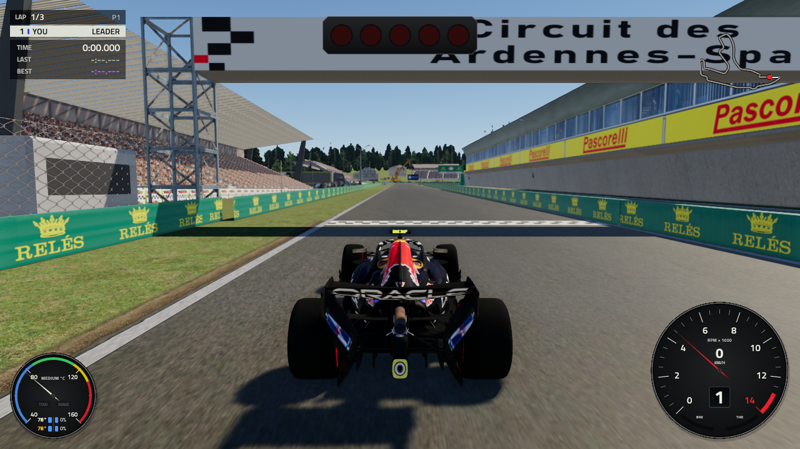
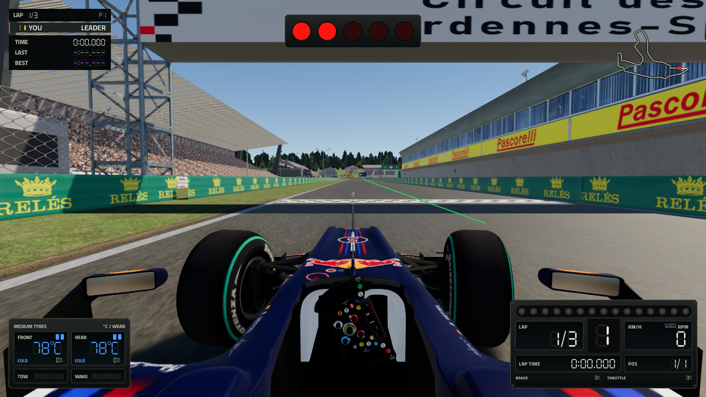
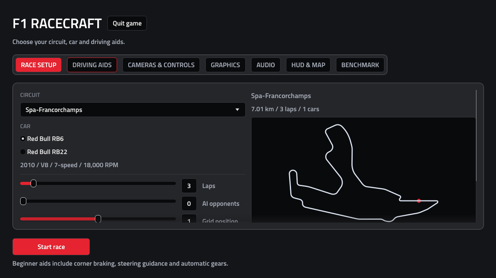
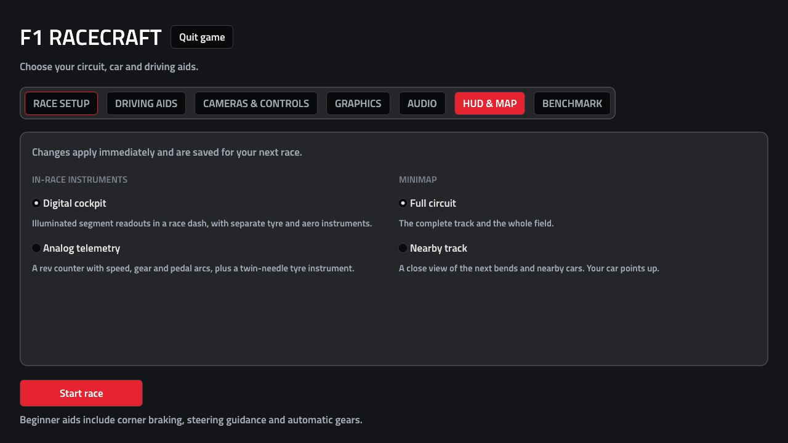

# Formula Game — F1 Racecraft

A formula-style racing game built with Rust and Bevy. Race at Spa-Francorchamps
with the 2022 ground-effect GEN22 or legacy RB6, configurable driving aids, AI opponents, and three camera views.



## Download and play

Get the Linux x86-64 AppImages from the [latest release](https://github.com/jR4dh3y/formula-game/releases/latest).
Both are self-contained: game assets, both cars, audio, fonts, and runtime libraries
are included. You do not need Rust or a separate assets download to play.

- **[Normal build](https://github.com/jR4dh3y/formula-game/releases/download/v0.1.0/F1-Racecraft-0.1.0-linux-x86_64.AppImage)** — the recommended build. Spa is the only supported circuit; unfinished circuits are disabled.
- **[Experimental build](https://github.com/jR4dh3y/formula-game/releases/download/v0.1.0/F1-Racecraft-0.1.0-exp-linux-x86_64.AppImage)** — adds Silverstone, Bahrain, and COTA. These circuits still need work. This build is compiled with `--features exp`.

Requires an x86-64 Linux desktop, kernel 6.1 or newer, and a Vulkan-capable GPU
with a working system driver. Windows and macOS binaries are not provided.

```sh
chmod +x F1-Racecraft-0.1.0-linux-x86_64.AppImage
./F1-Racecraft-0.1.0-linux-x86_64.AppImage
```

Use the `-exp` filename in those commands for the experimental build. The AppImages
fall back to extraction if FUSE mounting is unavailable. Release assets include
`SHA256SUMS`; download it alongside an AppImage and run `sha256sum --check --ignore-missing SHA256SUMS`.

## What you can do

- Drive the V8-era RB6 or modern GEN22 against up to 15 AI opponents.
- Set race length, grid position, tyres, and front/rear wings.
- Choose Beginner, Balanced, or Unassisted driving, with separate steering, braking, traction, and stability aids.
- Switch between cockpit, TV pod, and chase cameras, and save camera positions per car.
- Choose digital or analog instruments, full-circuit or nearby minimaps, and graphics presets.
- Select V6 turbo hybrid, V8, or V12 procedural engine voices and adjust the sound mix.

**Start here:** choose your car in Race setup, leave Beginner aids enabled, and
select Start race. Hold **W** to accelerate, use **A/D** to steer and **S** to brake.
**Esc** opens the pause menu; **C** cycles cameras; **R** recovers the car.

## Screenshots

RB6 cockpit at Spa, captured from the normal AppImage:



Race setup in the normal Spa-only build:



HUD and minimap settings:



These are captures from the game, not concept renders.

## Development

A Bevy 0.20 racing game with a deterministic 360 Hz simcade simulation. Select a circuit, car and driving aids from the in-game menu, then race against up to 15 AI drivers. The default GEN22 field uses the 2022 teams and drivers; the legacy RB6 field matches the V8-era sound and proportions. The simulation includes manual gearing, tyre temperature and wear, wing setup, slipstream, dirty air, car contacts, track collisions, timing and results.

### Run from source

Install Rust 1.97.1 or newer and your platform's Bevy build dependencies. On Linux this includes a Vulkan driver, development libraries for Wayland/X11, ALSA and udev, and a linker.

```sh
cargo run -p f1-the-game -- --assets /path/to/assets --auto-gears
```

The generated assets are separate from this repository. [Download the complete assets ZIP](https://fbs.jr4.in/s/f1-assets) using this permanent link. Extract the ZIP into the repository root to create `./assets`, or point `--assets` at an existing converted asset tree:

```text
assets/
  tracks/spa/{track.json,collision.bin,visual.glb}
  cars/gen22/{car.json,car.glb,car_lod1.glb,teams.json,liveries/}
  cars/rb6/{car.json,car.glb}
```

`tools/track/convert_spa.py` converts the upstream Spa track; `tools/car/prepare_car.py` prepares car models through Blender. Their module docstrings describe the source formats and arguments. The game uses the glTF files directly through Bevy. Car scenes must contain `body`, `wheel_fl`, `wheel_fr`, `wheel_rl` and `wheel_rr` nodes, with wheel pivots at their centres. The simulation and assets use +Z forward, +Y up, +X left, in metres.

Normal launches open Race setup. Choose the circuit, car, laps, AI field, grid slot, tyres and wings, then select Start race. The race waits for its scenes to load before starting the countdown. `--quick-race` skips the menu using the CLI configuration; `--frames` also skips it for capture/testing. Use `--car gen22 --team ferrari --driver leclerc` to choose a 2022 entry, or `--car rb6` for a legacy race. Team and driver default to the first team and its first driver in `teams.json`; `--car rb22` remains a deprecated alias for `gen22`. Run `cargo run -p f1-the-game -- --help` for the full CLI.

**Spa is the only supported circuit in normal builds.** Other track assets are hidden from the menu and rejected by `--track`. To enable unfinished circuits for development, build or run with the opt-in Cargo feature: `cargo run --release -p f1-the-game --features exp -- --assets ./assets`. Experimental builds discover converted circuits such as Silverstone, Bahrain and COTA; deferred Nürburgring assets remain unavailable until their conversion is repaired. The ignored `assets` symlink points at the original asset tree for convenient local launching.

The Graphics tab offers Low, Medium, High (default) and Ultra presets, applied immediately and saved with your preferences; `--graphics low|medium|high|ultra` sets one from the command line. Leaving the window during a race opens the pause menu, and rendering is throttled while the window is unfocused.

Driving aids has Beginner, Balanced and Unassisted presets. Beginner is the default, including automatic gears. Steering guidance follows the racing line when you release steering; strong manual steering overrides it. Corner braking anticipates bends, adds brake pressure and reduces a held accelerator. ABS, traction and stability are separate controls. You still control acceleration. The coloured racing line previews corner speed, and STEER / BRAKE indicators light up during interventions. Pause-menu changes apply immediately. Unassisted disables all aids and automatic shifting.

Aids and per-car camera positions persist in `$XDG_CONFIG_HOME/f1-racecraft/preferences.json` (or `~/.config/f1-racecraft/preferences.json`). `F1_SETTINGS` overrides the file. Explicit CLI aid settings override saved aids; `--quick-race` and capture runs use their CLI configuration without reading or writing preferences. Start new race replaces the current session; Resume race keeps it.

## Performance

On Linux with the NVIDIA driver under Wayland, the game presents through XWayland: NVIDIA's native Wayland presentation waits for each frame to finish before returning, which serialized CPU and GPU work (set `F1_WAYLAND=1` to keep native Wayland). Sky lighting is generated once per circuit rather than every frame. Together these took the High preset from 115 to 236 fps uncapped on an RTX 3050 laptop with unchanged output. Vertical sync is on by default; turn it off in Graphics or with `--no-vsync`.

- `--benchmark DIR` runs the comparison workload: two computer-controlled cars
  already moving, separated on the racing line, for 20 seconds. It checks the
  complete drive before opening the window and rejects contact or recovery.
  The measured drive must match that preflight exactly. Loading and warm-up
  are excluded, and VSync is disabled.
- Use the same `--benchmark-seed N` (default 24301), `--benchmark-start M`,
  track, car, camera, resolution and graphics preset for comparisons. Six
  seeded random sample times cover the run. Their exact states are rendered
  after timing, so PNG readback does not inflate frame times.
- Each fresh output directory contains `benchmark.json`, `frames.csv` and six
  PNGs. The report includes frame-time percentiles, 1% low FPS, workload state
  hashes and asset fingerprints. Changed asset fingerprints are expected when
  comparing visual changes; keep them equal when measuring code alone.
- `--frames N --capture FILE` remains a capture utility. Its old FPS log is
  diagnostic, not the repeatable moving benchmark.
- `F1_DETERMINISTIC=1` with a capture run advances exactly 1/60 s per frame and restarts temporal jitter with the race, so captures from different builds can be compared pixel by pixel.
- `F1_PROFILE=1` logs per-pass CPU and GPU timings; `--features profile` writes a Chrome trace for ui.perfetto.dev.
- F3 shows frame rate and frame times in game.

The **Benchmark** tab in the main or pause menu launches this same workload in
a separate window, preserving your current race. It uses the selected circuit,
car, camera, graphics preset and current window resolution. When it finishes,
the tab shows average FPS, 1% low FPS, p95 frame time and a selectable output
folder under `$XDG_CACHE_HOME/f1-racecraft/benchmarks` (or
`~/.cache/f1-racecraft/benchmarks`). Sound is muted during the test.

```sh
cargo run --release -p f1-the-game -- --assets ./assets --track spa --car rb6 \
  --camera chase --size 1920x1080 --graphics high --mute \
  --benchmark "$HOME/.cache/racecraft-baseline" --benchmark-seed 24301
```

`tools/verify_benchmark.sh ASSETS NEW_OUTPUT_DIRECTORY` runs two identical
native Vulkan benchmarks on an isolated Weston display and verifies the
reports, screenshot files and repeated drive hashes. It requires Weston and
a Vulkan-capable GPU. Frame times can differ with GPU load and clock speed;
the repeatability check compares the workload, not a performance threshold.

`tools/verify_settings.sh ASSETS NEW_OUTPUT_DIRECTORY` checks all seven menu
tabs, pause and camera-editor layouts at 1920×1080, 958×1078 and 640×600. It
clicks the Benchmark button on the wide layout, waits for the real child
process and report, and checks that the original race stays paused and intact.

## Portable Linux build

`CARGO_BUILD_JOBS=3 python3 tools/package/build_appimage.py` builds a single
`dist/F1-Racecraft-0.1.0-linux-x86_64.AppImage` containing the game, both cars,
Spa, sound, fonts and runtime libraries. Send that file;
players do not need Rust, the repository, separate assets or FUSE installed.
They need an x86-64 Linux desktop (kernel 6.1+) and a working Vulkan GPU driver. The image
automatically extracts and runs when mounting is unavailable. See
[packaging notes](tools/package/README.md) for controls, rebuilding and provenance.

For an experimental package containing the other converted tracks, run
`CARGO_BUILD_JOBS=3 python3 tools/package/build_appimage.py --exp`. This compiles
with `--features exp` and writes `dist/F1-Racecraft-0.1.0-exp-linux-x86_64.AppImage`.
Normal packaging always builds without `exp` and includes only Spa.

## Controls

| Action | Keyboard | Gamepad |
| --- | --- | --- |
| Throttle / brake | W / S or up / down | RT / LT |
| Steer | A / D or left / right | Left stick |
| Shift up / down | E or Shift / Q or Ctrl | RB or A / LB or X |
| Cycle camera | C | Y |
| Adjust camera against live scene | F4; F4 / Esc to resume | — |
| Cockpit / TV pod / third person | 1 / 2 / 3, or on-screen buttons | Cycle with Y |
| Recover to track | R | Back / Select |
| Pause menu / resume | Escape or P | Start |
| Mute / unmute | M | — |
| Frame-rate readout | F3 | — |
| Quit | Quit game in menu, or window close | Window close |

There are exactly three camera modes: seated cockpit, TV pod above the driver's head, and third-person chase. Use 1 / 2 / 3, C, or Cameras & controls. F4 pauses the race with a live camera preview: adjust height, forward position, pitch, field of view, vibration and horizon stabilization. Positions save separately for RB6 and GEN22. Camera cuts reset temporal history; chase smoothing accounts for car velocity to avoid trailing farther behind at speed. `--manual-gears` disables automatic shifting. Keyboard steering and brake pressure are smoothed; gamepad steering has a deadzone and response curve.

The RB6 and GEN22 cockpit steering wheels turn with the interpolated front-wheel steering angle, including steering assistance, at a 6:1 ratio. GEN22 uses the named `steering_wheel` node, including its live LCD and LEDs; RB6 keeps its legacy wheel and screen pod.

F toggles the Gen22 DRS flap during racing; braking closes it. This currently controls the visual flap only; DRS zone rules and aerodynamic effects remain unimplemented.

Import custom car, suit and helmet PNGs with `tools/car/import_livery.py`; it exports matching UV guides and preserves imported artwork through asset rebuilds. See [the PNG workflow](docs/gen22-car.md#importing-your-png-artwork). Monoposto sheets require UV conversion before use.


The HUD includes the timing tower, lap times, countdown lights, race messages, shift lights, speed, pedals, tyre temperatures/wear, lock-up/sliding indicators, aero effects, minimap and results.

Open **HUD & map** from Race setup or the pause menu to choose between **Digital cockpit**, with illuminated segments and a neutral gear aperture, and **Analog telemetry**, with separate metal-rimmed RPM, speed, pedal and G-force instruments. Tyre temperatures and live tow/wake effects use needle gauges in both layouts. The unboxed minimap supports Full circuit and Nearby track modes. Driving-aid buttons, camera shortcut strips and map headings are omitted while racing; their settings and keyboard shortcuts remain available. The G-force plot uses one G per ring. Both layouts use live simulation data and leave the physical cockpit wheel visible.

The minimap setting is independent: **Full circuit** shows the whole field; **Nearby track** follows the car through a 600 m window with the road ahead pointing up. Both choices apply immediately, survive new races, and are saved with your other preferences. Automated capture runs use the defaults and never write your preferences.

## Engine sound

The engine voices are synthesized in real time from cylinder firing pulses, exhaust-pipe resonances and intake noise. The RB6 defaults to a high-revving flat-plane V8; the GEN22 uses a V6 turbo hybrid with turbo spool, lift-off chatter and electric whine. The **Audio** settings tab also offers a Ferrari-inspired V12 voice on either car. These are stylized procedural interpretations, not recordings of specific Ferrari engines. Sound overrides map the car's idle-to-redline range onto the chosen voice without changing its physics.

The mix adds the three nearest rivals with stereo placement, distance filtering and Doppler shift, plus tyre scrub/lock-up squeal, wind, kerb and off-road rumble, drivetrain whine and collision thumps. Cockpit and external views have different balances. A gentle presence dip, stereo-linked compression and soft limiting control harshness and leave output headroom. Saved sliders control master volume, your engine, other cars and effects. Press M to mute; pause and mute fade smoothly, and `--mute` starts muted.

No external audio assets are needed by the active sound system. The previous sampled voices remain under `game/audio/reference` and `game/audio/v8` with their existing credits, but are not played. Their conversion script remains under `tools/audio/`.

Export three 16-second listening demos (idle, throttle blips, acceleration, shifts and braking):

```sh
cargo test -p f1-the-game export_engine_demos -- --ignored --nocapture
```

This writes `f1-engine-v6-hybrid.wav`, `f1-engine-v8.wav` and `f1-engine-v12.wav` to the system temporary directory (usually `/tmp`).

Track and car PNG textures receive linear-light mipmaps and 16× anisotropic filtering at load time. Temporal antialiasing stabilizes fine detail; camera changes reset its history to avoid carrying the old view into the new one.

Imported car paint is calibrated as coated composite rather than polished metal; tyres stay matte. Car contact shadows, short-range ambient occlusion, higher-resolution shadow maps and additional daylight fill help the cars sit on the track. Chase and onboard views use tighter framing.

## Verify

```sh
cargo test --workspace --lib --bins
# Both HUDs and both map modes, menu radio input, wide/tall captures and saved preferences:
XDG_RUNTIME_DIR=/run/user/$(id -u) tools/verify_hud.sh
F1_TEST_ASSETS=/path/to/assets cargo test -p f1-the-game spa_guidance -- --ignored --nocapture
F1_TEST_ASSETS=/path/to/assets cargo test -p racecraft-sim --test spa -- --nocapture
cargo run -p f1-the-game -- --assets /path/to/assets --frames 180 --capture /tmp/f1-bevy.png
# Full renderer check with injected controls, camera editor and twelve screenshots:
F1_TEST_ASSETS=/path/to/assets cargo test -p f1-the-game rendered_game_flows -- --ignored --nocapture
# Real menu pointer input, live aids, Spa race launches and both car models:
F1_TEST_ASSETS=/path/to/full/original/assets cargo test -p f1-the-game rendered_menu_and_track_selection -- --ignored --nocapture
F1_TEST_ASSETS=/path/to/assets cargo test -p f1-the-game --test cli_exit -- --ignored --nocapture

# Audio device check (plays a brief engine sound):
cargo test -p f1-the-game live_engine_playback -- --ignored --nocapture
```

Capture counts frames after scene loading and exits after writing the image. Missing assets and screenshot-write errors return a failing exit code. Spa integration tests print a skip notice when no generated assets are available; use `F1_TEST_ASSETS` to run them against an external tree.

The ignored renderer tests need a Vulkan-capable display. The gameplay check verifies scene hierarchy, car materials, driving, all three cameras, pause/resume and recovery, and writes grid/cockpit/onboard/paused/racing/results screenshots plus both instrument layouts and both map modes under `/tmp/f1-bevy-proof`. Its results screenshot uses a forced finish state; race completion is covered by the simulation tests. The menu check clicks actual egui tabs, aid presets, both HUD/map selectors and Start, switches through Spa and both cars (all four circuits with `--features exp`), checks that old scene roots are removed, and confirms live aid changes while paused. Set `F1_TEST_OUTPUT` to choose a capture directory. `tools/verify_hud.sh` runs these checks on an isolated Weston/XWayland display and captures landscape and tall-window layouts; it requires Weston and a Vulkan-capable GPU. The existing Spa AI lap-time benchmark still fails its unchanged target; see MIGRATION.md for the baseline comparison.

The CLI exit test launches separate game processes, quits after 1 and 12 frames, captures the first frame, and checks a failed screenshot write. Pipeline compilation runs on Bevy's render thread to prevent early shutdown racing a background GPU compiler worker. First-use pipeline compilation can block a frame; this avoids the reproduced NVIDIA teardown crash.

## Code

Bevy is the sole active game engine. Keep game rendering, input, UI, audio and cameras
in `game/`, physics and race rules in `sim/`, and asset tools in `tools/`.
The independent `archive/custom-engine/` workspace is frozen and excluded from normal builds.

- `game/`: Bevy app, glTF entities, input, three camera modes, daylight, menus and HUD through `bevy_egui`.
- `sim/`: renderer-independent physics, AI and race rules. Post-migration polish fixes reverse engine braking, repeated shifts during a torque cut, and stale crash dynamics after recovery while preserving tyre condition and timing.
- `tools/`: asset converters.
- `archive/custom-engine/`: complete frozen custom-engine workspace, excluded from the active build. Includes the legacy engine, client, simulation, lockfile and asset tools from the last custom-engine `main` revision.

See [MIGRATION.md](MIGRATION.md) for migration coverage and recorded verification limits. The historical gameplay design in [the archived handoff](archive/custom-engine/handoff.md) also describes future features; those are not all implemented.

## Credits

Track and car assets retain their upstream ownership and attribution; see the
[asset conversion notes](tools/track/README.md). The repository's historical audio
sources have [reference credits](game/audio/reference/CREDITS.md) and
[V8 source credits](game/audio/v8/CREDITS_LICENSE.md); the active voices are procedural.
The bundled font uses the [SIL Open Font License](game/fonts/OFL.txt).
AppImages include runtime package metadata and applicable license texts; see the
[packaging notes](tools/package/README.md).
