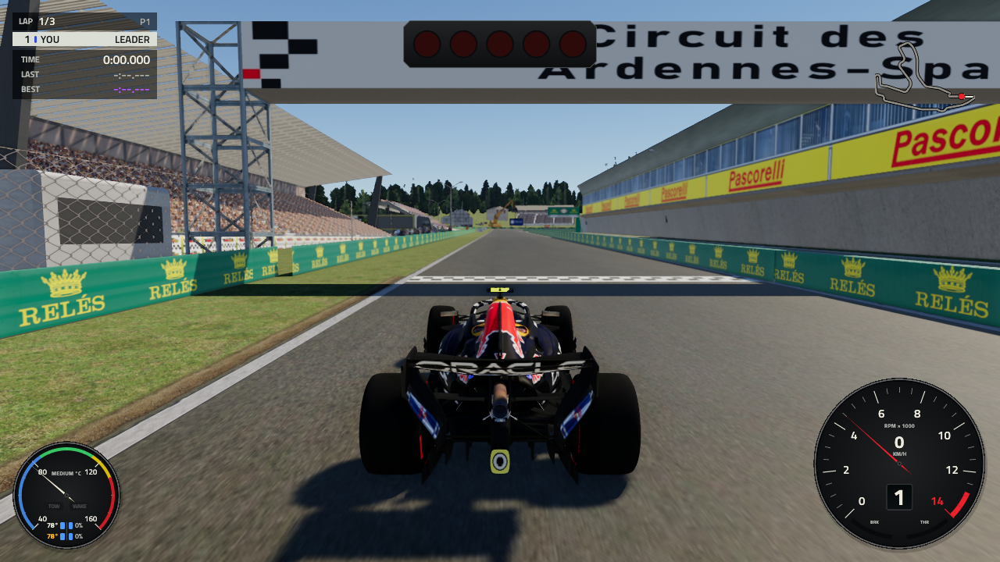
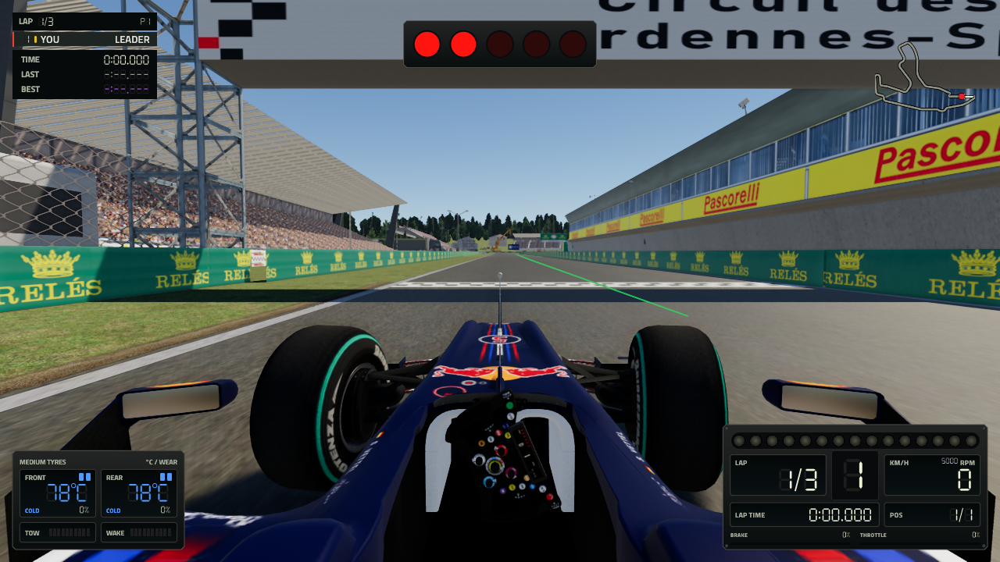
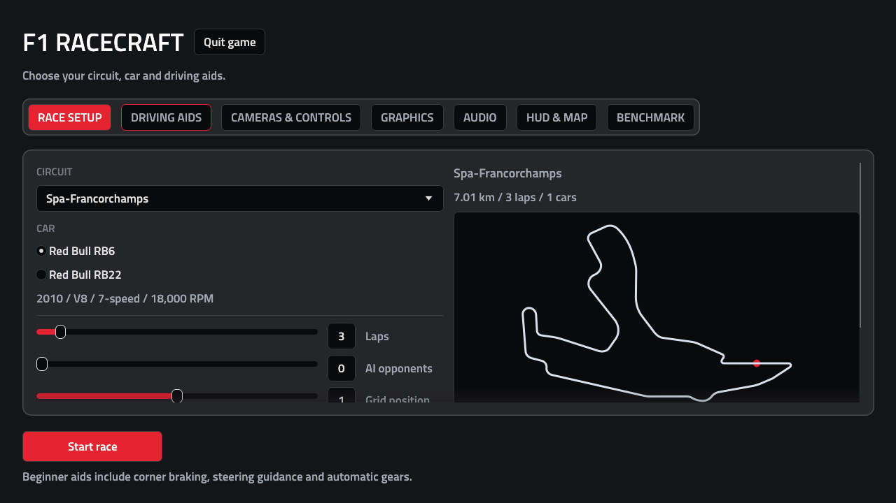
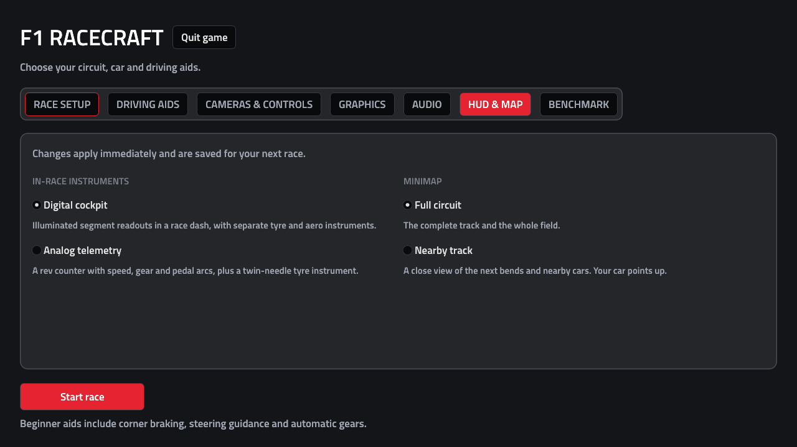

# Formula Game — F1 Racecraft

A formula-style racing game built with Rust and Bevy. Race at Spa-Francorchamps
with the 2022 ground-effect GEN22 or legacy RB6, configurable driving aids, AI opponents, and three camera views.



## Download and play

Download the [latest release](https://github.com/jR4dh3y/formula-game/releases/latest).
Each release includes three self-contained x86-64 builds: a portable Windows
`.exe`, a recommended Linux AppImage with Spa, and an experimental Linux
AppImage that also enables Silverstone, Bahrain, and COTA. Game assets, both
cars, audio, fonts, and required runtime files are baked into the downloads;
players do not need Rust or a separate assets folder. `SHA256SUMS` contains the
checksums for all three builds.

Linux builds require a desktop on kernel 6.1 or newer and a Vulkan-capable GPU
with a working system driver. The Windows build requires 64-bit Windows 10/11,
a Vulkan-capable GPU with its current driver, and 500 MB of temporary space.
See [the Windows build guide](tools/package/WINDOWS.md) for launcher details.

Pushing a version tag such as `v0.1.1` after updating the workspace version in
`Cargo.toml` automatically builds these packages and publishes them to a GitHub
Release. The build workflow can also be run manually to produce downloadable
workflow artifacts without publishing a release.

Replace `VERSION` below with the version in the downloaded filename. Use
`-exp-linux` for the experimental build.

```sh
chmod +x F1-Racecraft-VERSION-linux-x86_64.AppImage
./F1-Racecraft-VERSION-linux-x86_64.AppImage
```

The AppImages fall back to extraction if FUSE mounting is unavailable. Verify a
download with `sha256sum --check --ignore-missing SHA256SUMS`.

## What you can do

- Drive the V8-era RB6 or modern GEN22 against up to 15 AI opponents.
- Set race length, grid position, tyres, and front/rear wings.
- Choose Beginner, Balanced, or Unassisted driving, with separate steering, braking, traction, and stability aids.
- Switch between cockpit, TV pod, and chase cameras, and save camera positions per car.
- Choose digital or analog instruments, full-circuit or nearby minimaps, and graphics presets.
- Select V6 turbo hybrid, V8, or V12 procedural engine voices and adjust the sound mix.

**Start here:** choose your car in Game play → Car setup, leave Beginner aids enabled, and
select Start race. Hold **W** to accelerate, use **A/D** to steer and **S** to brake.
**Esc** opens the pause menu; **C** cycles cameras; **R** recovers the car;
**F** (gamepad **B**) opens DRS when the badge above the dash is outlined green.

## Screenshots

RB6 cockpit at Spa, captured from the normal AppImage:



Race setup in the normal Spa-only build:



HUD and minimap settings:



These are captures from the game, not concept renders.

## Multiplayer

Multiplayer supports 16-driver host/join rooms, owner-controlled rules,
AI takeover, local prediction and a headless UDP/WebSocket server.
[Host on Render](docs/render.md) and join with `wss://your-service.onrender.com`. See
[setup, platform packages and verification limits](docs/multiplayer.md).

```sh
cargo run --release -p f1-the-game -- --assets ./assets --car rb6 --host 7777 --name Alice
cargo run --release -p f1-the-game -- --assets ./assets --car rb6 --join 192.168.1.20:7777 --name Bob
```

## Development

A Bevy 0.20 racing game with a deterministic 360 Hz simcade simulation. Select a circuit, car and driving aids from the in-game menu, then race against up to 15 AI drivers. The default GEN22 field uses the 2022 teams and drivers; the legacy RB6 field matches the V8-era sound and proportions. The simulation includes manual gearing, tyre temperature and wear, wing setup, slipstream, dirty air, car contacts, track collisions, timing and results.

### Run from source

Install Rust 1.97.1 or newer and your platform's Bevy build dependencies. On Linux this includes a Vulkan driver, development libraries for Wayland/X11, ALSA and udev, and a linker.

```sh
cargo run -p f1-the-game -- --assets /path/to/assets --auto-gears
```

The generated assets are separate from this repository. [Download the complete assets ZIP](https://github.com/jR4dh3y/formula-game/releases/download/assets-68ae3a48b726ffa5/f1-racecraft-assets.zip) using this permanent link. Extract the ZIP into the repository root to create `./assets`, or point `--assets` at an existing converted asset tree; team liveries ship separately: [download the liveries ZIP](https://github.com/jR4dh3y/formula-game/releases/download/liveries-0a14081c2385c999/f1-racecraft-liveries.zip) (SHA-256 `0a14081c2385c99923169c91a1daadd8a3e28d632bde82e104bf025c29c7c911`) and extract it into the repository root as well, so it lands in `assets/cars/gen22/liveries/`. Release builds overlay it automatically. Asset tree:

```text
assets/
  tracks/spa/{track.json,collision.bin,visual.glb}
  cars/gen22/{car.json,car.glb,car_lod1.glb,car_lod2.glb,teams.json}
  cars/rb6/{car.json,car.glb}
```

`tools/track/convert_spa.py` converts the upstream Spa track; `tools/car/prepare_car.py` prepares car models through Blender. Their module docstrings describe the source formats and arguments. The game uses the glTF files directly through Bevy. Car scenes must contain `body`, `wheel_fl`, `wheel_fr`, `wheel_rl` and `wheel_rr` nodes, with wheel pivots at their centres. The simulation and assets use +Z forward, +Y up, +X left, in metres.

Normal launches open Game play with the Track tab selected. Choose the circuit, laps, AI field, grid slot, tyres and wings there. Open its Car setup tab to choose the car, team and driver by name, then select Start race. Track and Car setup show the circuit outline with a live car preview beneath it. The race waits for its scenes to load before starting the countdown. `--quick-race` skips the menu using the CLI configuration; `--frames` also skips it for capture/testing. GEN22 uses a shared car model with installed team and driver liveries. Missing artwork falls back to neutral paint. Team and driver selections also control race identities and HUD colours. Use `--car gen22 --team ferrari --driver leclerc` to choose a 2022 entry, or `--car rb6` for a legacy race. `--car gen26` races the 2026-regulation car when `assets/cars/gen26` is installed (`tools/build_assets.sh cars` builds the base car from `2026-redbull-rb22.zip`; `tools/car/build_gen26.sh <dir>` builds each team's own car from its Sketchfab GLB, and the grid then races in team cars). It has no DRS: its wings switch into a low-drag straight mode by themselves on every long straight and close for braking or corners. A 4 MJ battery drives a 350 kW MGU-K that tapers off above 290 km/h and recharges under braking, off the throttle and by super clipping. F (gamepad B) is the overtake button: within a second of the car ahead at an overtake detection point it engages overtake mode (+0.5 MJ and full power to 337 km/h); anywhere else it toggles a boost that spends the battery until you brake. Overtake mode spends only its own allowance at full power. H (gamepad D-pad down) toggles harvest mode: no deployment and heavy super clipping at full throttle above 120 km/h, to refill the battery; it ends by itself when the battery is full. The HUD's DRS lamp becomes the battery gauge. `cargo test --release -p racecraft-sim --test era_probe -- --ignored --nocapture` compares lap time, top speed and energy per lap for all three eras on the installed circuits. **Drift mode** (`--drift`, or Mode → Drift in the menu) puts a 260 kW drift-build Mahindra Thar Roxx on the generated Racecraft Drift Park. Traction and stability control and the line guidance are off; Space (gamepad D-pad left) is the handbrake. Slides between 12° and 110° above 25 km/h score points by angle and speed; linking slides raises a multiplier up to x5, a chain banks after 1.2 s straight, and a spin, a wall or the grass loses it. `tools/track/generate_drift.py` builds the park; `THAR_SOURCE=<glb> tools/build_assets.sh cars` converts the car. `cargo test --release -p racecraft-sim --test drift_probe -- --ignored --nocapture` checks its drift envelope headlessly. Team and driver default to the first team and its first driver in `teams.json`; `--car rb22` remains a deprecated alias for `gen22`. Run `cargo run -p f1-the-game -- --help` for the full CLI.

**Spa is the only supported circuit in normal builds.** Other track assets are hidden from the menu and rejected by `--track`. To enable unfinished circuits for development, build or run with the opt-in Cargo feature: `cargo run --release -p f1-the-game --features exp -- --assets ./assets`. Experimental builds discover converted circuits such as Silverstone, Bahrain and COTA; deferred Nürburgring assets remain unavailable until their conversion is repaired. The ignored `assets` symlink points at the original asset tree for convenient local launching.

High keeps temporal anti-aliasing, two sun-shadow cascades with a close first cascade,
contact shadows, bloom, speed-scaled motion blur, runtime asphalt grain/roughness,
faint rubber on the racing line, and wheel smoke, grass/gravel dust, skid marks and
compression sparks. Medium drops bloom and motion blur and uses smaller effect
budgets. Low disables the new material and surface effects. Ultra adds SSAO, 4096
shadow maps and four shadow cascades. Full-resolution textures are a separate
Texture detail choice: they add about 800 MB of video memory and exhaust a 4 GB
card that a desktop is also using. Motion blur scales with speed and
remains individually adjustable on every preset. At 1920x1080 on an RTX 3050 laptop
the moving benchmark measures about 112 fps on High and 200 fps on Low.

Graphics → Asphalt detail, Daylight balance, Camera motion and Surface effects can
be toggled separately. Camera → Chase dynamics controls speed pullback, FOV expansion,
load sway and corner lead, saved per car. Vibration stays separately adjustable.
Sparks use high-speed kerb load or suspension/ground lag as a compression proxy;
the sim does not expose physical plank clearance. Effects use race time and bounded
budgets, including nearby AI. Source assets are not rewritten.

The Graphics settings page offers Low, Medium, High (default) and Ultra presets, applied immediately and saved with your preferences; `--graphics low|medium|high|ultra` sets one from the command line. Leaving the window during a race opens the pause menu, and rendering is throttled while the window is unfocused.

Both HUD layouts and wheel dashboards average telemetry on physics ticks. Speed and RPM use a 100 ms window, gaps and tyre/aero readouts use 250 ms, and the best-lap delta uses 200 ms. Numbers refresh at 20 Hz; gears, pedals and warning lights stay immediate. Running clocks show tenths, while completed lap and sector times retain milliseconds. The timing strip keeps all three sector splits, marking old splits LAST until replaced. Position-change notices require 300 ms of continuous change with at least one metre clearance.

Game play → Driving assistance has Beginner, Balanced and Unassisted presets. Beginner is the default, including automatic gears. Steering assistance works in two stages. Up to 50% it steadies the wheel and limits steering lock with speed, and you do all the steering; Balanced sits at 50%. Above 50% it also guides the car along the racing line when you release steering; strong manual steering overrides it. Corner braking anticipates bends and reduces a held accelerator only while adding brake pressure. It preserves your throttle input when it is not braking, including when pulling alongside another car. ABS, traction and stability are separate controls. When steering and stability are both at least 50%, a grip-based turn-in limit also prevents yaw overshoot; this limit switches on fully rather than blending with the slider. Beginner and Balanced engage it; Unassisted does not. Opposite lock remains available to catch slides. Above 50% stability, near-limit steering on racing surfaces builds low-speed yaw more gradually while retaining full steady cornering grip. At those settings, aided steering returns and countersteers faster than it turns in, reducing the delay when releasing the wheel or catching a slide. A centred gamepad stick releases its command immediately; keyboard steering retains its return ramp. You still control acceleration. The coloured racing line previews corner speed, and STEER / BRAKE indicators light up during interventions. Pause-menu changes apply immediately. Unassisted disables all aids and automatic shifting.

Aids and per-car camera positions persist in `$XDG_CONFIG_HOME/f1-racecraft/preferences.json` (or `~/.config/f1-racecraft/preferences.json`). `F1_SETTINGS` overrides the file. Explicit CLI aid settings override saved aids; `--quick-race` and capture runs use their CLI configuration without reading or writing preferences. Start new race replaces the current session; Resume race keeps it.

## Performance

On Linux with the NVIDIA driver under Wayland, the game presents through XWayland: NVIDIA's native Wayland presentation waits for each frame to finish before returning, which serialized CPU and GPU work (set `F1_WAYLAND=1` to keep native Wayland). Sky lighting is generated once per circuit rather than every frame. The historical 115-to-236 fps comparison predates the current GEN22 graphics settings; it is not a current performance guarantee. Vertical sync is on by default; turn it off in Graphics or with `--no-vsync`.

- `--benchmark DIR` runs the comparison workload: the selected field, including an automated player,
  already moving and separated on the racing line, for 20 seconds. It checks the
  complete drive before opening the window and rejects contact or recovery.
  The measured drive must match that preflight exactly. Loading and warm-up
  are excluded, and VSync is disabled.
- Use the same `--benchmark-seed N` (default 24301), `--benchmark-start M`,
  track, car, camera, resolution and graphics preset for comparisons. Six
  seeded random sample times cover the run. Their exact states are rendered
  after timing, so PNG readback does not inflate frame times.
- Each fresh output directory contains `benchmark.json`, `frames.csv` and six
  PNGs. The report includes frame-time percentiles, 1% low FPS, workload state
  hashes and asset fingerprints. Changed asset fingerprints are expected when
  comparing visual changes; keep them equal when measuring code alone.
- `--benchmark-grid --benchmark DIR` measures the stationary default grid for
  20 seconds, retaining all cars and the player camera. Use it separately from
  the moving workload to check the packed field. Reports record physical render
  resolution, window size, field size and the selected asset fingerprints.
- `--frames N --capture FILE` remains a capture utility. Its old FPS log is
  diagnostic, not the repeatable moving benchmark.
- `F1_DETERMINISTIC=1` with a capture run advances exactly 1/60 s per frame and restarts temporal jitter with the race, so captures from different builds can be compared pixel by pixel.
- Settings → Graphics has presets plus detailed video settings (anti-aliasing, sharpening, shadows, ambient occlusion, sky, haze, texture detail, AI car detail and Bevy post-processing). Texture detail applies from the next race. Imported textures use BC7 on supported GPUs. The first load encodes and caches blocks in `$XDG_CACHE_HOME/f1-racecraft/bc7-v1`, or `~/.cache/f1-racecraft/bc7-v1`; later loads reuse them. `F1_VIDEO` takes a JSON `graphics::Video` and overrides the settings, including for `--frames` captures and benchmarks.
- `F1_PROFILE=1` logs per-pass CPU and GPU timings; `--features profile` writes a Chrome trace for ui.perfetto.dev.
- F3 shows frame rate and frame times in game.

The **Benchmark** tab in the main or pause menu launches this same workload in
a separate window, preserving your current race. It uses the selected circuit,
car, camera, graphics preset and current window resolution. When it finishes,
the tab shows average FPS, 1% low FPS, p95 frame time and a selectable output
folder under `$XDG_CACHE_HOME/f1-racecraft/benchmarks` (or
`~/.cache/f1-racecraft/benchmarks`). Sound is muted during the test.

```sh
cargo run --release -p f1-the-game -- --assets ./assets --track spa --car rb6 \
  --camera chase --size 1920x1080 --graphics high --mute \
  --benchmark "$HOME/.cache/racecraft-baseline" --benchmark-seed 24301
```

`tools/verify_benchmark.sh ASSETS NEW_OUTPUT_DIRECTORY` runs two identical
native Vulkan benchmarks on an isolated Weston display and verifies the
reports, screenshot files and repeated drive hashes. It requires Weston and
a Vulkan-capable GPU. Frame times can differ with GPU load and clock speed;
the repeatability check compares the workload, not a performance threshold.

`tools/verify_visuals.py perf OUTPUT` compares explicit `F1_VIDEO` effects-off and
preset settings at High and Low, twice each. Run it inside a 1920×1080 Weston
XWayland session, using the same options as `tools/verify_benchmark.sh`; the script
waits for other builds/game processes, records process/GPU evidence and video JSON,
and rejects a run if another build/game starts during measurement. `profile` adds
per-pass timing and pipeline/image-event traces; `ultra` checks the full preset.
`captures OUTPUT --replay-binary PATH` uses the compiled ignored
`visual_review::scripted_captures` test to save matched grid, 320 km/h, corner,
cockpit, braking, lock-up, grass excursion, compression-spark and storm scenes.
Build that test with `cargo test --release -p f1-the-game --no-run` and use the
printed `f1_the_game-*` executable. The replay uses real `Race::step` inputs and
writes wheel telemetry, effect kinds and camera bounds beside the PNGs.

`tools/verify_settings.sh ASSETS NEW_OUTPUT_DIRECTORY` checks all ten menu
tabs, pause and camera-editor layouts at 1920×1080, 958×1078 and 640×600. It
clicks the Benchmark button on the wide layout, waits for the real child
process and report, and checks that the original race stays paused and intact.

## Portable Linux build

`CARGO_BUILD_JOBS=3 python3 tools/package/build_appimage.py` builds a single
`dist/F1-Racecraft-2.0.0-linux-x86_64.AppImage` containing the game, both cars,
Spa, sound, fonts and runtime libraries. Send that file;
players do not need Rust, the repository, separate assets or FUSE installed.
They need an x86-64 Linux desktop (kernel 6.1+) and a working Vulkan GPU driver. The image
automatically extracts and runs when mounting is unavailable. See
[packaging notes](tools/package/README.md) for controls, rebuilding and provenance.

For an experimental package containing the other converted tracks, run
`CARGO_BUILD_JOBS=3 python3 tools/package/build_appimage.py --exp`. This compiles
with `--features exp` and writes `dist/F1-Racecraft-2.0.0-exp-linux-x86_64.AppImage`.
Normal packaging always builds without `exp` and includes only Spa.

## Controls

| Action | Keyboard | Gamepad |
| --- | --- | --- |
| Throttle / brake | W / S or up / down | RT / LT |
| Steer | A / D or left / right | Left stick |
| Shift up / down | E or Shift / Q or Ctrl | RB or A / LB or X |
| Cycle camera | C | Y |
| Adjust camera against live scene | F4; F4 / Esc to resume | — |
| Cockpit / TV pod / third person | 1 / 2 / 3, or on-screen buttons | Cycle with Y |
| Recover to track | R | Back / Select |
| Pause menu / resume | Escape or P | Start |
| Mute / unmute | M | — |
| Frame-rate readout | F3 | — |
| Quit | Quit game in menu, or window close | Window close |

There are exactly three camera modes: seated cockpit, TV pod above the driver's head, and third-person chase. Use 1 / 2 / 3, C, or the Camera page. F4 pauses the race with a live camera preview: adjust height, forward position, pitch, field of view, vibration and horizon stabilization. Positions save separately for RB6 and GEN22. Camera cuts reset temporal history; chase smoothing accounts for car velocity to avoid trailing farther behind at speed. `--manual-gears` disables automatic shifting. Keyboard steering and brake pressure are smoothed; gamepad steering has a deadzone and response curve.

The RB6 and GEN22 cockpit steering wheels turn with the interpolated front-wheel steering angle, including steering assistance, at a 6:1 ratio. GEN22 uses the named `steering_wheel` node, including its live LCD and LEDs; RB6 keeps its legacy wheel and screen pod.

GEN22 opponents use exterior-only near and distant models. The player alone carries
the full source steering wheel and cockpit controls. The full player geometry
remains visible; a sun-only LOD1 proxy casts its shadow,
and opponents use LOD2 shadow proxies when available. Triangle indices are
reordered once on load to reuse GPU vertex work without reducing geometry.
Opponent meshes crossfade around 40 m; older asset packages without `car_lod2.glb` use LOD1 throughout.

On GEN22, press F or gamepad East to press the DRS cap with the driver's left thumb, even when DRS is unavailable. The wheel LCD uses the HUD's DRS states: dim when unavailable, outlined green when ready, solid green while open. Braking closes the flap. Button and dial legends retain their source UVs independently of the live LCD.

DRS follows the modern rules. Each circuit gets up to two zones, found from its
longest straights that end in a braking corner (at Spa: Kemmel into Les Combes,
and the pit straight into La Source). From lap 2, a car within one second of the
car ahead at a zone's detection point may open the flap in that zone with F
(gamepad B). AI cars use it whenever it is earned. Braking or leaving the zone
closes it. An open flap removes about 10% of the car's drag and some rear
downforce. The 2010 RB6 predates DRS and has none.

**DRS anywhere** (Game play → Driving assistance, or `--drs-anywhere`) drops the zone and
one-second rules for your car: F opens the flap anywhere on track from the
start, and braking still closes it. AI cars keep to the race rules. The
setting is saved with your other aids.

GEN22 retains original per-part UVs and baked ambient occlusion, with neutral body paint. The player model retains a detailed cockpit with distinct carbon, brass, anodized metal, coloured controls and stickers. Opponents use a lighter mesh with projected normal maps. See [the asset contract](docs/gen22-car.md) for source preparation, rebuilds and comparison renders.


The HUD includes the timing tower, lap times, countdown lights, race messages, shift lights, speed, pedals, tyre temperatures/wear, lock-up/sliding indicators, aero effects, minimap and results.

Open **Interface** from the settings sidebar or the pause menu to choose between **Digital cockpit**, with illuminated segments and a neutral gear aperture, and **Analog telemetry**, with separate metal-rimmed RPM, speed, pedal and G-force instruments. Tyre temperatures and live tow/wake effects use needle gauges in both layouts. The unboxed minimap supports Full circuit and Nearby track modes. Driving-aid buttons, camera shortcut strips and map headings are omitted while racing; their settings and keyboard shortcuts remain available. The G-force plot uses one G per ring. Lap timing follows the selected instrument finish. Digital tyre wear sits beside each axle label; analog tyre temperatures appear only on the two-needle scale, with Front/Rear keys and wear below. Both layouts use live simulation data and leave the physical cockpit wheel visible.

The minimap setting is independent: **Full circuit** shows the whole field; **Nearby track** magnifies the road around the car with the road ahead pointing up, while compressing distant sections to keep the complete circuit visible. Neither mode uses a rectangular background or crops the track. Both choices apply immediately, survive new races, and are saved with your other preferences. Automated capture runs use the defaults and never write your preferences.

## Engine sound

The engine voices are synthesized in real time from cylinder firing pulses, exhaust-pipe resonances and intake noise. The RB6 defaults to a high-revving flat-plane V8; the GEN22 uses a V6 turbo hybrid with turbo spool, lift-off chatter and electric whine. The **Audio** settings tab also offers a Ferrari-inspired V12 voice on either car. These are stylized procedural interpretations, not recordings of specific Ferrari engines. Sound overrides map the car's idle-to-redline range onto the chosen voice without changing its physics.

The mix adds the three nearest rivals with stereo placement, distance filtering and Doppler shift, plus tyre scrub/lock-up squeal, wind, kerb and off-road rumble, drivetrain whine and collision thumps. Cockpit and external views have different balances. A gentle presence dip, stereo-linked compression and soft limiting control harshness and leave output headroom. Saved sliders control master volume, your engine, other cars and effects. Press M to mute; pause and mute fade smoothly, and `--mute` starts muted.

No external audio assets are needed by the active sound system. The previous sampled voices remain under `game/audio/reference` and `game/audio/v8` with their existing credits, but are not played. Their conversion script remains under `tools/audio/`.

Export three 16-second listening demos (idle, throttle blips, acceleration, shifts and braking):

```sh
cargo test -p f1-the-game export_engine_demos -- --ignored --nocapture
```

This writes `f1-engine-v6-hybrid.wav`, `f1-engine-v8.wav` and `f1-engine-v12.wav` to the system temporary directory (usually `/tmp`).

Track and car PNG textures receive linear-light mipmaps and 16× anisotropic filtering at load time. Temporal antialiasing stabilizes fine detail; camera changes reset its history to avoid carrying the old view into the new one.

Imported car paint is calibrated as coated composite rather than polished metal; tyres stay matte. Car contact shadows, short-range ambient occlusion, higher-resolution shadow maps and additional daylight fill help the cars sit on the track. Chase and onboard views use tighter framing.

## Verify

```sh
cargo test --workspace --lib --bins
# Both HUDs and both map modes, menu radio input, wide/tall captures and saved preferences:
XDG_RUNTIME_DIR=/run/user/$(id -u) tools/verify_hud.sh
F1_TEST_ASSETS=/path/to/assets cargo test -p f1-the-game spa_guidance -- --ignored --nocapture
F1_TEST_ASSETS=/path/to/assets cargo test -p racecraft-sim --test spa -- --nocapture
cargo run -p f1-the-game -- --assets /path/to/assets --frames 180 --capture /tmp/f1-bevy.png
# Full renderer check with injected controls, camera editor and twelve screenshots:
F1_TEST_ASSETS=/path/to/assets cargo test -p f1-the-game rendered_game_flows -- --ignored --nocapture
# GEN22 direct-template player and opponent LOD1/LOD2 review, thirteen captures:
F1_TEST_ASSETS=/path/to/assets cargo test -p f1-the-game rendered_car_review -- --ignored --nocapture
# GEN22 DRS key presses, thumb/cap release, both LODs and eight cockpit captures:
F1_TEST_ASSETS=/path/to/assets cargo test -p f1-the-game rendered_wheel_drs_controls -- --ignored --nocapture
# Real menu pointer input, live aids, Spa race launches and both car models:
F1_TEST_ASSETS=/path/to/full/original/assets cargo test -p f1-the-game rendered_menu_and_track_selection -- --ignored --nocapture
F1_TEST_ASSETS=/path/to/assets cargo test -p f1-the-game --test cli_exit -- --ignored --nocapture

# Audio device check (plays a brief engine sound):
cargo test -p f1-the-game live_engine_playback -- --ignored --nocapture
```

Capture counts frames after scene loading and exits after writing the image. Missing assets and screenshot-write errors return a failing exit code. Spa integration tests print a skip notice when no generated assets are available; use `F1_TEST_ASSETS` to run them against an external tree.

The ignored renderer tests need a Vulkan-capable display. The gameplay check verifies scene hierarchy, car materials, driving, all three cameras, pause/resume and recovery, and writes grid/cockpit/onboard/paused/racing/results screenshots plus both instrument layouts and both map modes under `/tmp/f1-bevy-proof`. Its results screenshot uses a forced finish state; race completion is covered by the simulation tests. The menu check clicks actual egui tabs, aid presets, both HUD/map selectors and Start, switches through Spa and both cars (all four circuits with `--features exp`), checks that old scene roots are removed, and confirms live aid changes while paused. Set `F1_TEST_OUTPUT` to choose a capture directory. `tools/verify_hud.sh` runs these checks on an isolated Weston/XWayland display and captures landscape and tall-window layouts; it requires Weston and a Vulkan-capable GPU. The Spa AI integration race passes its lap-time ceiling (best ~125 s from a standing start; ~116 s flying laps).

The CLI exit test launches separate game processes, quits after 1 and 12 frames, captures the first frame, and checks a failed screenshot write. Pipeline compilation runs on Bevy's render thread to prevent early shutdown racing a background GPU compiler worker. First-use pipeline compilation can block a frame; this avoids the reproduced NVIDIA teardown crash.

## Code

Bevy is the sole active game engine. Keep game rendering, input, UI, audio and cameras
in `game/`, physics and race rules in `sim/`, and asset tools in `tools/`.
The independent `archive/custom-engine/` workspace is frozen and excluded from normal builds.

- `game/`: Bevy app, glTF entities, input, three camera modes, daylight, menus and HUD through `bevy_egui`.
- `sim/`: renderer-independent physics, AI and race rules. Post-migration polish fixes reverse engine braking, repeated shifts during a torque cut, and stale crash dynamics after recovery while preserving tyre condition and timing.
- `tools/`: asset converters.
- `archive/custom-engine/`: complete frozen custom-engine workspace, excluded from the active build. Includes the legacy engine, client, simulation, lockfile and asset tools from the last custom-engine `main` revision.

See [MIGRATION.md](MIGRATION.md) for migration coverage and recorded verification limits. The historical gameplay design in [the archived handoff](archive/custom-engine/handoff.md) also describes future features; those are not all implemented.

## Credits

Track and car assets retain their upstream ownership and attribution; see the
[asset conversion notes](tools/track/README.md). The repository's historical audio
sources have [reference credits](game/audio/reference/CREDITS.md) and
[V8 source credits](game/audio/v8/CREDITS_LICENSE.md); the active voices are procedural.
The 2026 team cars (`assets/cars/gen26`) are Dave Love's 2026 grid models
([Sketchfab: Tyler_Dave](https://sketchfab.com/Tyler_Dave/models)): RB22,
SF-26, W17, MCL40, AMR26, FW48, VF-26, R26 and MAC-26, each licensed
[CC BY 4.0](https://creativecommons.org/licenses/by/4.0/) and listed in
[tools/car/gen26_teams.json](tools/car/gen26_teams.json). They are converted
for the game: wheels and the rear-wing flap split into their own nodes, and
opponent copies decimated with textures capped at 2048 px. The drift-mode car is built from
["Mahindra - Thar Roxx"](https://sketchfab.com/3d-models/mahindra-thar-roxx-f85210fe98774b7fab1199d8ee151ead)
by ansari_studios, licensed [CC BY 4.0](https://creativecommons.org/licenses/by/4.0/),
converted for the game (scaled to metres, wheels split into their own nodes).
The drift park is generated by the repository's own tooling. The bundled font uses the [SIL Open Font License](game/fonts/OFL.txt).
AppImages include runtime package metadata and applicable license texts; see the
[packaging notes](tools/package/README.md).

### Dry weather skies

Game play → Track has **Clear sky** and **Storm**. Storm darkens the sky and
scene, with occasional lightning and delayed thunder. Both modes keep the
track dry and leave tyre grip unchanged. Thunder uses the Sound effects and
Master controls, follows mute, and stops while paused.

Use `--weather clear` or `--weather storm` for quick races, captures and
benchmarks. Interactive launches remember the selected weather; an explicit
CLI choice overrides it. The CC0 Poly Haven cubemaps are embedded in the
executable, including packaged builds. Sources, credit and conversion steps
are in [game/sky/CREDITS.md](game/sky/CREDITS.md).

### Offline driver progression

Clean driving builds a points chain up to ×5. Passes use the HUD's confirmed
position changes; tow, close racing, speed marks, clean sectors/laps and personal
bests also score. Four quiet seconds bank the chain. Contact, recovery and leaving
the track lose the pending chain. Finished races award XP and driver levels,
without locking any cars or circuits. Driver records live beside preferences in
`progress.json`; quick races, captures, benchmarks and `F1_SETTINGS` overrides
never read or write records.

Press Z or click the right stick to return to a recent snapshot, losing the chain,
then wait for the two-second resume pause. Graphics settings can disable rewind.
Hold T or the left stick for 1.5 seconds to restart. Pause and finish panels offer
Restart and Next: one more lap, reusing the loaded scene. These controls and rewards
are offline only. Rewind is disabled for capture and benchmark runs.
